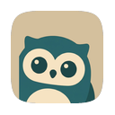
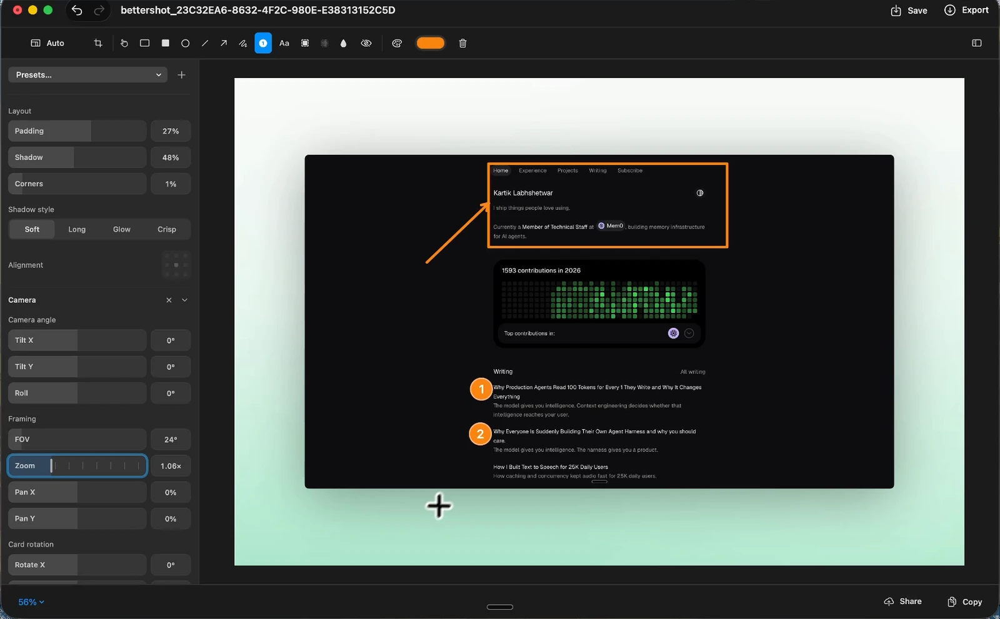
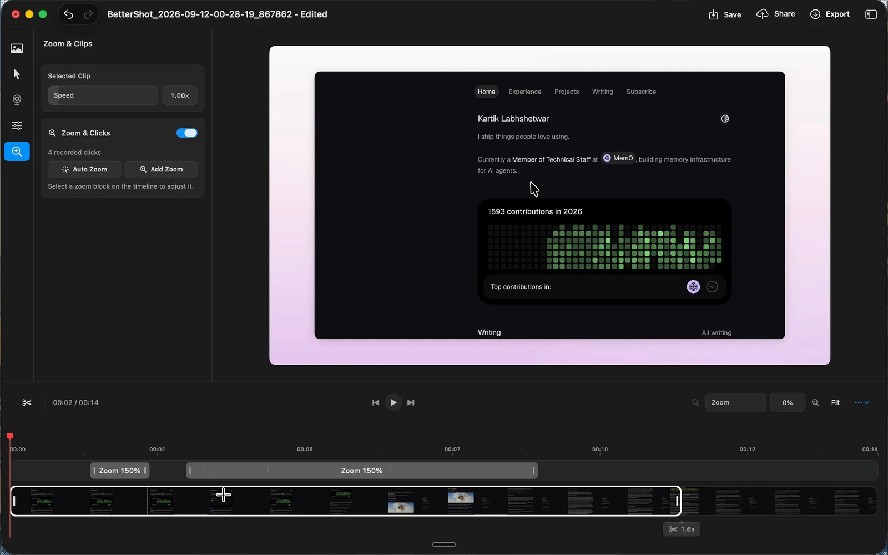

<p align="center">
  
</p>

<h1 align="center">BetterShot</h1>

<p align="center">
  <strong>Capture, edit, and share your screen. Native on macOS.</strong>
</p>

<p align="center">
<a href="https://trendshift.io/repositories/18174?utm_source=trendshift-badge&amp;utm_medium=badge&amp;utm_campaign=badge-trendshift-18174" target="_blank" rel="noopener noreferrer"></a>
</p>

<p align="center">
  <a href="https://github.com/KartikLabhshetwar/better-shot/releases/latest"></a>
  
  <a href="https://github.com/KartikLabhshetwar/better-shot/actions/workflows/build.yml"></a>
  <a href="LICENSE"></a>
</p>

<p align="center">
  <a href="https://github.com/KartikLabhshetwar/better-shot/releases/latest">Download</a> ·
  <a href="https://bettershot.site">Website</a> ·
  <a href="CHANGELOG.md">Changelog</a> ·
  <a href="CONTRIBUTING.md">Contribute</a> ·
  <a href="https://github.com/KartikLabhshetwar/better-shot/issues">Report a bug</a>
</p>

BetterShot is a free, open-source Mac app for screenshots, screen recordings,
and image and video editing. No account or subscription.



## Install

```bash
brew install --cask bettershot
```

Or download the Apple silicon or Intel `.dmg` from
[Releases](https://github.com/KartikLabhshetwar/better-shot/releases/latest).

Requires macOS 14 or later. Microphone narration needs macOS 15, and narration
subtitles and teleprompter speech tracking need macOS 26.

## Features

- **Screenshots:** region, window, fullscreen, and scrolling capture, plus OCR and a color picker.
- **Image editor:** arrows, shapes, text, numbered markers, highlights, blur, and pixelate.
  Crop, rotate, flip, and frame captures with backgrounds, padding, corners, and shadow.
- **Recording:** a display, window, or area, with system audio, microphone, camera, and a teleprompter.
- **Video editor:** combine library recordings, then cut, arrange, or change clip speed.
  Edit each recording's zooms, captions, masks, camera layout, cursor, and 3D shots.
  Export MP4 or MOV at 30 or 60 fps.
- **Sharing:** copy, save, pin, or drag from the floating preview, browse everything in the
  Media Gallery, and share links through your own Cloudflare R2 bucket.
- Let a local AI agent inspect and edit saved recordings through [Agent Access](#agent-access).

Original captures and source recordings are never modified.

<details>
<summary>See the video editor</summary>



</details>

## Getting started

1. Open BetterShot. Setup asks for Screen Recording and Accessibility access and
   where to save screenshots.
2. Press `⌘⇧4` and select an area.
3. Copy, Save, Edit, Pin, or Share from the floating preview.

| Action | Shortcut |
| --- | --- |
| Region screenshot | `⌘⇧4` |
| Fullscreen screenshot | `⌘⇧3` |
| Capture previous region | `⌘⇧1` |
| Capture and recording bar | `⌘⇧2` |
| Recording options | `⌘⇧5` |
| OCR text scan | `⌘⇧O` |
| Color picker | `⌘⇧C` |

Change shortcuts in **Settings > Shortcuts**. New installs save screenshots to the
Desktop; change the folder, file names, or automatic saving in
**Settings > General > Saving**.

## Permissions

| Permission | Used for |
| --- | --- |
| Screen & System Audio Recording | Screenshots, recordings, and system audio |
| Accessibility | Global shortcuts |
| Input Monitoring | Cursor effects and shortcut overlays. Plain typing is never recorded. |
| Microphone | Voice in recordings |
| Camera | Camera recording |

If capture or shortcuts still fail after granting access, quit and reopen BetterShot.
When BetterShot opens at login before macOS applies Screen Recording access, it
offers to restart itself the first time you capture.

## Combine recordings

Open a recording in Studio and choose **Add Recording** to append another recording
from your BetterShot library. BetterShot copies its editable source into the
project and preserves the original. You can also choose an already combined
project: its clips retain their arrangement, effects, and canvas fitting while
remaining individually editable. The destination keeps its export settings.

The left inspector lists the project's recordings. **Edit Recording** opens its
existing background, cursor, camera, and effect controls. **Apply** updates every
clip using that recording in one undo step; **Cancel** discards the local changes.
Trim, cut, and change speed on the main timeline. Right-click a clip for **Move Clip
Earlier** or **Move Clip Later**, or select it in the filmstrip and press
**Control–Option–Left Arrow** or **Control–Option–Right Arrow**. Each recording keeps
its authored effects and proportions, fitted into the common output canvas.

For a combined project with audio, **Export Audio** in the left inspector exports
the composed soundtrack in the selected format. Before quitting, finish an open
Add/Edit Recording sheet with **Add Recording**, **Apply**, or **Cancel**.

## Agent Access

Agent Access is off by default. Turn it on under **Settings > Agent Access**, then
choose **Copy Client Configuration** and paste the JSON into your agent's MCP
server settings. The configuration contains a private token; keep it on this
Mac. **Rotate Token** invalidates old copies, and switching Agent Access off
closes the local endpoint and revokes its token.

An agent can list recordings in BetterShot's library, open one in Studio,
inspect its timeline and recording sources, request a composed PNG preview,
append another library recording, reorder clips, split, trim, delete, or change
clip speed, undo or redo, save the project, and start or check an export. Saving a project that already has an exported video also starts updating
that file, with progress shown in Studio. Exports use your configured save folder. Each edit requires the current
project revision, so an agent must inspect again if you edit the same project
in the UI. Export status remains available for the 16 most recent agent jobs
while their project stays open. The endpoint listens only on this Mac at
`127.0.0.1:39615`; it does not provide arbitrary file access or cloud-upload tools.

For MCP clients, `append_recording` takes a library `projectId`, target `handle`,
`expectedRevision`, and UUID `requestId`. Reuse the same ID and arguments to retry
the same append safely, including concurrent retries. A failed ID retains its
failure; use a new ID for a fresh attempt. At most four distinct appends can be
preparing at once. `reorder_clips` takes every current clip ID exactly once in the
desired order. For clips with a `sourceId`, trim bounds use that recording's
authored editor time; the outer clip speed multiplies its authored speed.
Native Add/Edit Recording transactions and pending audio/caption preparation block
agent edits until they finish.

`inspect_effects` returns visual settings, supported capabilities, and preset
catalogs without file paths. `set_effects` edits backgrounds, framing, cursor,
camera, zoom, crop, Blur/Pixelate masks, built-in 3D shots, and existing overlay
settings in one undo step. For a combined project, supply a recording's `sourceId`
from `inspect_timeline`; omit it for a single recording. Omitted settings stay
unchanged. Supplied effect arrays replace the whole collection, with at most 64
items; inspection supports pages of up to 64 items with total counts. See the
[contributor guide](CONTRIBUTING.md#local-agent-access) for timing and a request
example.

## Cloud sharing

Optional. Sharing uploads to a Cloudflare R2 bucket you own.

1. Create an R2 bucket with a public URL and an
   [API token](https://developers.cloudflare.com/r2/api/tokens/) with Object Read & Write access.
2. Enter the credentials in **Settings > Sharing**, choose the bucket's **Jurisdiction**
   if it has one, and click **Test Connection**.
3. Click **Share** on any capture to upload it and copy the link.

Credentials are stored in your login Keychain, and anyone with a link can view it.
Outside of sharing, BetterShot only goes online to check GitHub for updates.

## Automation

Trigger captures from Shortcuts, Raycast, or the terminal:

```bash
open 'bettershot://capture/region'
```

| Route | Action |
| --- | --- |
| `capture/region` | Region screenshot |
| `capture/fullscreen` | Fullscreen screenshot |
| `capture/window` | Window screenshot |
| `capture/scroll` | Scrolling capture |
| `ocr` | OCR text scan |
| `color-picker` | Color picker |
| `record` | Start a recording |
| `settings` | Open Settings |

## Build from source

Requires Xcode 26 and [XcodeGen](https://github.com/yonaskolb/XcodeGen).

```bash
brew install xcodegen
git clone https://github.com/KartikLabhshetwar/better-shot.git
cd better-shot
make release
open .build/Build/Products/Release/BetterShot.app
```

See [CONTRIBUTING.md](CONTRIBUTING.md) for Xcode setup, the code map, and tests.

## Contributing

Issues and pull requests are welcome. Read the [contributor guide](CONTRIBUTING.md)
and [Code of Conduct](CODE_OF_CONDUCT.md) first.

Built by [Kartik Labhshetwar](https://x.com/code_kartik) and
[contributors](https://github.com/KartikLabhshetwar/better-shot/graphs/contributors).
If BetterShot helps you, consider [supporting its development](https://www.buymeacoffee.com/code_kartik).
