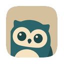
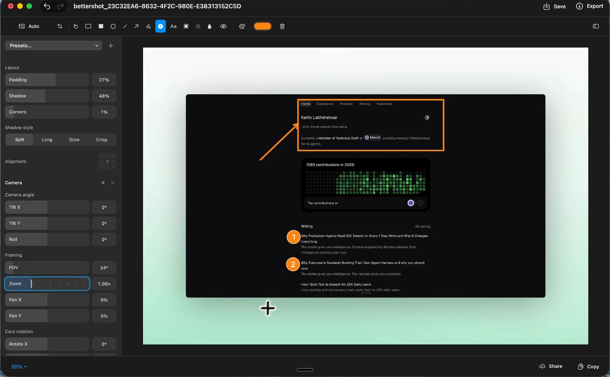
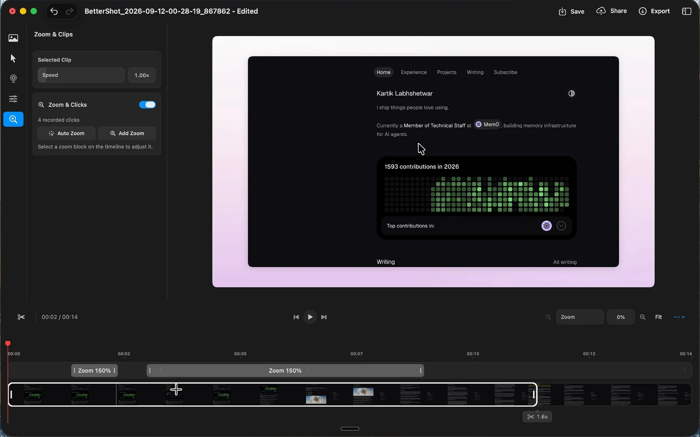

<p align="center">
  
</p>

<h1 align="center">BetterShot</h1>

<p align="center">
  <strong>Capture, edit, and share your screen. Native on macOS.</strong>
</p>

<p align="center">
<a href="https://trendshift.io/repositories/18174?utm_source=trendshift-badge&amp;utm_medium=badge&amp;utm_campaign=badge-trendshift-18174" target="_blank" rel="noopener noreferrer"></a>
</p>

<p align="center">
  <a href="https://github.com/KartikLabhshetwar/better-shot/releases/latest"></a>
  
  <a href="https://github.com/KartikLabhshetwar/better-shot/actions/workflows/build.yml"></a>
  <a href="LICENSE"></a>
</p>

<p align="center">
  <a href="https://github.com/KartikLabhshetwar/better-shot/releases/latest">Download</a> ·
  <a href="https://bettershot.site">Website</a> ·
  <a href="CHANGELOG.md">Changelog</a> ·
  <a href="CONTRIBUTING.md">Contribute</a> ·
  <a href="https://github.com/KartikLabhshetwar/better-shot/issues">Report a bug</a>
</p>

BetterShot is a free, open-source Mac app for screenshots, screen recordings,
and image and video editing. No account or subscription.



## Install

```bash
brew install --cask bettershot
```

Or download the Apple silicon or Intel `.dmg` from
[Releases](https://github.com/KartikLabhshetwar/better-shot/releases/latest).

Requires macOS 14 or later. Microphone narration needs macOS 15, and narration
subtitles and teleprompter speech tracking need macOS 26.

## Features

- **Screenshots:** region, window, fullscreen, and scrolling capture, plus OCR and a color picker.
- **Image editor:** arrows, shapes, text, numbered markers, highlights, blur, and pixelate.
  Crop, rotate, flip, and frame captures with backgrounds, padding, corners, and shadow.
- **Recording:** a display, window, or area, with system audio, microphone, camera, and a teleprompter.
- **Video editor:** cuts, speed, zooms, captions, masks, camera layouts, cursor styles, and 3D shots.
  Export MP4 or MOV at 30 or 60 fps.
- **Sharing:** copy, save, pin, or drag from the floating preview, browse everything in the
  Media Gallery, and share links through your own Cloudflare R2 bucket.

Original captures and source recordings are never modified.

<details>
<summary>See the video editor</summary>



</details>

## Getting started

1. Open BetterShot. Setup asks for Screen Recording and Accessibility access and
   where to save screenshots.
2. Press `⌘⇧4` and select an area.
3. Copy, Save, Edit, Pin, or Share from the floating preview.

| Action | Shortcut |
| --- | --- |
| Region screenshot | `⌘⇧4` |
| Fullscreen screenshot | `⌘⇧3` |
| Capture previous region | `⌘⇧1` |
| Capture and recording bar | `⌘⇧2` |
| Recording options | `⌘⇧5` |
| OCR text scan | `⌘⇧O` |
| Color picker | `⌘⇧C` |

Change shortcuts in **Settings > Shortcuts**. New installs save screenshots to the
Desktop; change the folder, file names, or automatic saving in
**Settings > General > Saving**.

## Permissions

| Permission | Used for |
| --- | --- |
| Screen & System Audio Recording | Screenshots, recordings, and system audio |
| Accessibility | Global shortcuts |
| Input Monitoring | Cursor effects and shortcut overlays. Plain typing is never recorded. |
| Microphone | Voice in recordings |
| Camera | Camera recording |

If capture or shortcuts still fail after granting access, quit and reopen BetterShot.

## Cloud sharing

Optional. Sharing uploads to a Cloudflare R2 bucket you own.

1. Create an R2 bucket with a public URL and an
   [API token](https://developers.cloudflare.com/r2/api/tokens/) with Object Read & Write access.
2. Enter the credentials in **Settings > Sharing**, choose the bucket's **Jurisdiction**
   if it has one, and click **Test Connection**.
3. Click **Share** on any capture to upload it and copy the link.

Credentials are stored in your login Keychain, and anyone with a link can view it.
Outside of sharing, BetterShot only goes online to check GitHub for updates.

## Automation

Trigger captures from Shortcuts, Raycast, or the terminal:

```bash
open 'bettershot://capture/region'
```

| Route | Action |
| --- | --- |
| `capture/region` | Region screenshot |
| `capture/fullscreen` | Fullscreen screenshot |
| `capture/window` | Window screenshot |
| `capture/scroll` | Scrolling capture |
| `ocr` | OCR text scan |
| `color-picker` | Color picker |
| `record` | Start a recording |
| `settings` | Open Settings |

## Build from source

Requires Xcode 26 and [XcodeGen](https://github.com/yonaskolb/XcodeGen).

```bash
brew install xcodegen
git clone https://github.com/KartikLabhshetwar/better-shot.git
cd better-shot
make release
open .build/Build/Products/Release/BetterShot.app
```

See [CONTRIBUTING.md](CONTRIBUTING.md) for Xcode setup, the code map, and tests.

## Contributing

Issues and pull requests are welcome. Read the [contributor guide](CONTRIBUTING.md)
and [Code of Conduct](CODE_OF_CONDUCT.md) first.

Built by [Kartik Labhshetwar](https://x.com/code_kartik) and
[contributors](https://github.com/KartikLabhshetwar/better-shot/graphs/contributors).
If BetterShot helps you, consider [supporting its development](https://www.buymeacoffee.com/code_kartik).
